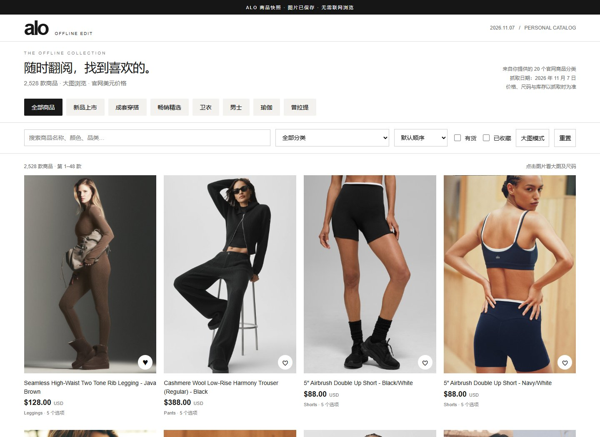
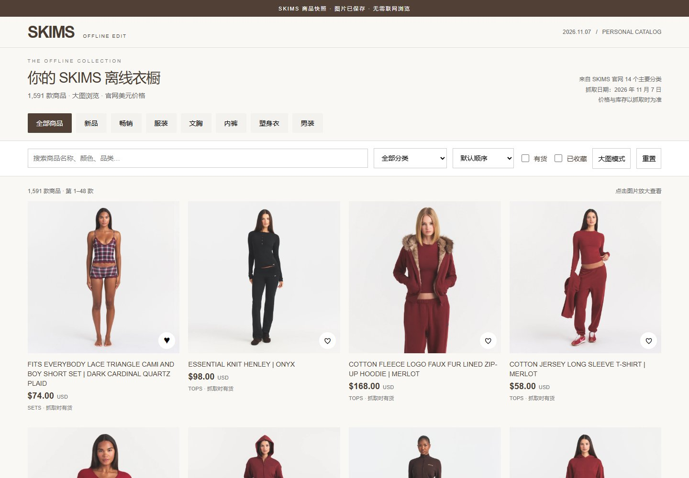

# Offline Shop Catalog

把支持的购物网站转换为可离线浏览的大图商品目录，输出 HTML、图片、JSON、可选 PDF 和 ZIP。适合先看清图片、价格，再回官网查看尺码或购买。

## 作品集：Alo & SKIMS

我为 Alo 和 SKIMS 制作了可在电脑与手机上离线浏览的商品目录，重点呈现商品大图与价格，并加入搜索、分类筛选和收藏功能。在完成这两个项目后，我将商品采集、图片保存与目录导出流程封装为可复用的工具，支持本地运行和 GitHub Actions。

以下展示两个项目于 2026 年 11 月 7 日完成的定制版界面。当前通用导出模板的布局可能与截图有所不同。

### Alo · 离线运动衣橱

**2,528 件去重商品 · 大图与美元价格 · 离线网页 / 手机 PDF / ZIP**

保留简洁的黑白风格，以大图网格展示商品，支持分类、搜索、排序、收藏及商品详情。

### SKIMS · 离线衣橱

**1,591 条商品/颜色记录 · 14 个主要分类 · 100 页分类数据 · 离线网页 / 手机 PDF / ZIP**

采用暖白与棕色界面，突出商品图片和价格，支持分类筛选与收藏。记录范围以分类页展示为准，不代表全部颜色或完整尺码库存。

以上为独立工具的效果展示，与 Alo / SKIMS 无隶属或背书关系。截图中的品牌、商品图片和文案属于各自权利人，不适用本仓库的 MIT 代码许可。仓库不附带完整商品数据、图片包或 PDF；快照价格与库存不会自动更新。

[开始使用](#快速开始) · [运行 GitHub Actions](https://github.com/meiikoo/offline-shop-catalog/actions/workflows/catalog.yml)

**这是可扩展工具，不是“任何网站都能抓”的承诺。** 不绕过登录、验证码、付费墙或访问限制。不同网站可能需要配置或新增适配器。源站文本只作为数据解析，不执行页面中的脚本指令。

## 支持范围

| 模式 | 输入 | 支持内容 | 限制 |
|---|---|---|---|
| shopify | Shopify 首页或分类页 | 分页、图片、价格区间、选项、库存 | 必须开放 products.json；币种优先读取 cart.js |
| skims | SKIMS 分类页 | 分页、列表商品、展示图、美元价格、商品库存 | 不包含延迟加载的全部颜色和完整尺码库存 |
| generic | 商品页或列表页 | JSON-LD Product / AggregateOffer，发现同域商品链接 | 仅限服务端 HTML；不能保证发现全站商品 |
| selectors | 自定义配置文件 | CSS 商品卡片、名称、价格、图片、下一页 | 需要按网站配置选择器和价格格式 |
| JSON 导入 | 标准化 JSON 数组 | 将其他爬虫的结果做成离线目录 | 输入字段必须匹配示例；远程图片需可访问 |

auto 对 Alo 使用 Shopify，对 SKIMS 使用专用适配器，对其他域名使用 generic。其他 Shopify 商店请明确指定 --adapter shopify。

## 快速开始

需要 Python 3.11+。Windows、macOS、Linux 均可运行。

~~~bash
python -m venv .venv
# Windows PowerShell
.venv\Scripts\Activate.ps1
# macOS / Linux
# source .venv/bin/activate
python -m pip install .
~~~

小规模试跑（先抓 20 条商品）：

~~~bash
python -m offline_catalog --url https://skims.com/collections/new-arrivals --max-products 20 --output output/skims-test --pdf
~~~

使用预设抓取多个主要分类：

~~~bash
python -m offline_catalog --config configs/skims.json --max-products 5000 --max-pages 500 --output output/skims-full --pdf
python -m offline_catalog --config configs/alo.json --max-products 5000 --max-pages 500 --output output/alo-full --pdf
~~~

其他 Shopify 商店：

~~~bash
python -m offline_catalog --url https://YOUR-STORE/collections/YOUR-COLLECTION --adapter shopify --output output/shop
~~~

其他网站的公开商品页或列表：

~~~bash
python -m offline_catalog --url https://YOUR-STORE/products/YOUR-PRODUCT --adapter generic --output output/custom --pdf
~~~

自定义 CSS 选择器：复制 configs/selectors.example.json，替换网址、选择器、币种，再运行：

~~~bash
python -m offline_catalog --config my-shop.json --output output/my-shop
~~~

导入已有爬虫结果：按 configs/import.example.json 映射字段。

~~~bash
python -m offline_catalog --input my-products.json --output output/imported --pdf
~~~

示例中的 example.com 是占位网址，不是可抓取的演示商店。

## 如何离线浏览

- 电脑：完整解压生成的 ZIP，打开文件夹内的 index.html。pictures 文件夹必须放在旁边。无需服务器或网络。
- 手机：将 catalog.pdf 保存到本机，用 PDF 阅读器打开，可放大图片和搜索商品名。
- 网页支持搜索、分类、币种筛选、价格排序、库存筛选、收藏、大图和可用的尺码选项。
- 不同币种不换算。价格排序先按币种分组；价格缺失显示“未提供”，不会当成 0。
- 收藏只保存在当前浏览器，部分手机文件预览器不支持 JavaScript 或本地存储。
- 原商品链接需要联网；价格、库存、运费及税费不会自动更新。

输出目录：

~~~text
output/catalog/
  index.html
  pictures/
  products.json
  report.json
  catalog.pdf       # --pdf 启用时
  READ-ME.txt
output/catalog-offline.zip
~~~

程序拒绝覆盖非空目录。再次运行时使用新目录。重试只处理当前请求，暂不支持中断续跑或差量更新。

## GitHub Actions 工作流

在本仓库运行，或 Fork 到自己的账号后运行：

1. 进入仓库 Actions → Build offline shopping catalog → Run workflow。
2. 选 skims、alo 或 custom。custom 填公开网址和适配器。
3. 设置 max_products / max_pages，勾选是否生成 PDF。
4. 运行结束，在 Artifacts 下载 offline-shopping-catalog。展开后有目录与独立 ZIP；无需两个都保留。
5. 下载结果请保存到本机，Actions 产物默认只保留 **7 天**。

默认只手动触发，不定时抓取，不发布 GitHub Pages，不自动提交商品数据。默认上限 200 条 / 50 页，是试跑预算，可能只覆盖预设的前几个分类。完整程度以 report.json 为准。

工作流使用 contents: read，用户输入通过环境变量和 Python 参数列表传递，不拼进 shell 命令。抓取失败时仍尽量上传 report.json；源站拒绝 GitHub 云端 IP 时，请在本地运行。

## 报告与失败处理

report.json 包含抓取时间（UTC）、来源、完成状态、页面数、去重商品数、限制、缺图列表、网络错误和提取限制。

- 返回码 0：成功导出。达到用户设定上限也返回 0，但报告标记 partial。
- 返回码 1：没有提取到商品，保留失败报告。
- 返回码 2：部分来源、图片或 PDF 失败，已得到的商品仍导出。
- 403 / 验证码 / 登录：停止该来源并报告；不绕过。
- 429 / 临时服务器错误：有界重试。使用 --delay 降低抓取频率。
- 缺少币种：明确标记币种未提供；可以在 source 配置中指定确认过的 currency。
- 混合币种的单个 JSON-LD 商品不合并价格；应使用地区专属网址。
- CSS 选择器价格支持单一数值；含多个价格或区间的卡片应选择精确的单个价格节点。

图片默认每款一张，最长 1000×1400 像素。每个响应设置大小上限。仅在用户控制的本机或手动 Actions 中运行；不要把它直接当作接收匿名 URL 的公开网络服务。

PDF 默认尝试嵌入本机中文/Unicode 字体；Linux 可安装 fonts-wqy-zenhei。也可用 --font /path/to/font.ttf 指定字体。缺乏对应字符字形时，应安装合适字体；完整原文始终保留在 HTML 与 JSON 中。PDF 商品长标题最多两行，以省略号标出截断。

## 新增网站适配器

入口在 offline_catalog/adapters.py。新增生成器 adapter(http, source, state)，逐项 yield product(...)：

~~~python
def my_store(http, source, state):
    if not state.page():
        return
    data = ...  # 读取网站允许访问的公开页面或接口
    for row in data:
        yield product(
            url=row['url'], title=row['name'], image=row['image'],
            price=row['price'], currency=row['currency'],
            available=None,
        )
~~~

将适配器加入 extract() 映射和 CLI 选项，编写离线 fixture 测试。分页必须检查结束条件与重复游标；未知价格、币种、库存保持 None，不推测。图片 URL 必须是 HTTP(S)。站点数据不能当成代码执行。

## 测试

~~~bash
python -m unittest discover -s tests -v
~~~

测试覆盖分页、重复页面、SKIMS 数据解码、JSON-LD、CSS 价格、缺失值、多币种、HTML 转义、PDF/ZIP 和失败报告。CI 使用 Windows/Linux 与 Python 3.11/3.12；单元测试不访问外部商店。真实站点可能改版，离线单元测试不保证实时网站一直可用。

## 许可证

本项目代码采用 [MIT License](LICENSE)。作品集截图中的第三方品牌、商品图片与文案不包含在此许可中。
